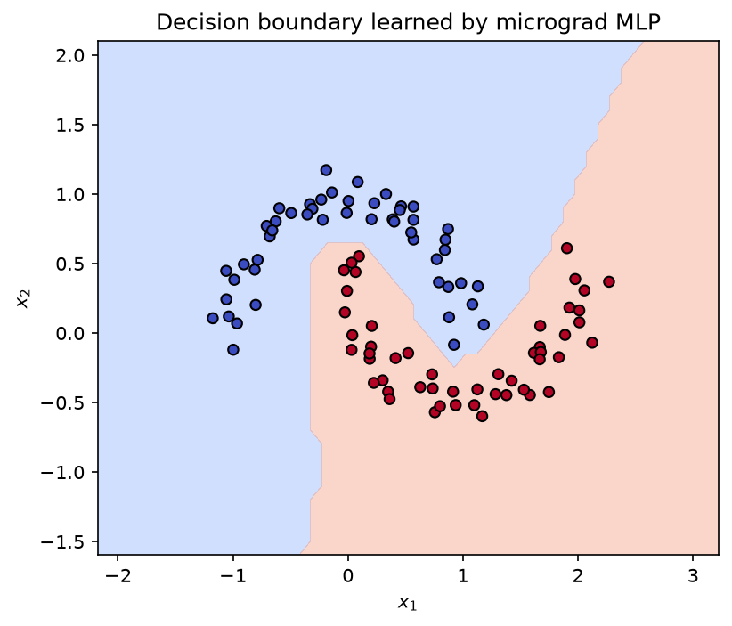

<div align="center">

# ml-from-scratch

**Core ML algorithms built from first principles, starting with neural networks.**


</div>

---

## About

I'm learning machine learning by implementing the core algorithms myself instead of calling them from a library. Each project is built from scratch, checked against a reference implementation (PyTorch or scikit-learn), and comes with a write-up of the math in my own words.

## Roadmap

| # | Project | What it covers | Status |
|:-:|---|---|:-:|
| 1 | [**neural-net**](./neural-net) | Scalar autograd engine, backpropagation, MLP from scratch | **Done** |

## Highlights



A 2 → 16 → 16 → 1 MLP built on my scalar autograd engine, reaching 100% training accuracy on `make_moons`.

## Getting started

```bash
git clone https://github.com/JiunSull/ml-from-scratch.git
cd ml-from-scratch
pip install -r requirements.txt
```

## Principles

- **Typed by hand**
- **Every implementation is checked against PyTorch or scikit-learn**

## References

- Andrej Karpathy, [*Neural Networks: Zero to Hero*](https://karpathy.ai/zero-to-hero.html)

## License

[MIT](LICENSE)
